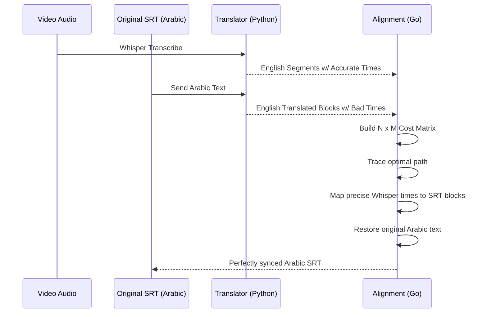

# Algorithms & Pipeline

This document explains the internal mechanisms of how out-of-sync subtitles are aligned to actual speech, regardless of the language they are written in.

## 1. The Language Barrier Problem

Standard subtitle synchronizers rely on text-matching: they transcribe the audio and match the generated text to the subtitle text. This completely fails if the audio is in one language (e.g., English) but the subtitles are in another (e.g., Arabic).

### Our Solution
1. **Auto-Detection:** Whisper analyzes the audio and detects the spoken language (e.g., `en`).
2. **Offline Translation:** If the SRT language (e.g., `ar`) does not match the spoken language (`en`), the Go worker passes the SRT blocks to `argostranslate` (an offline neural machine translation tool). 
3. The Arabic text is translated to English. Now we have two sets of English text: the accurate but unformatted Whisper transcription, and the correctly formatted but badly-timed SRT text.

## 2. The Dynamic Time Warping (DTW) Alignment

Once both sources of text are in the same language, we use a custom implementation of **Dynamic Time Warping (DTW)** to map them.

### Why DTW instead of greedy matching?
If a character speaks a sentence that the translator interprets differently than Whisper, a "greedy" search might miss the match. If it misses, a greedy algorithm loses its place and fails to sync the rest of the movie. DTW builds a full $N \times M$ matrix to find the **globally optimal** path through all subtitle blocks and speech segments, guaranteeing recovery from temporary desyncs.

### The Algorithm Steps

1. **Normalization:** 
   Both the Whisper segments and the translated SRT blocks are normalized (converted to lowercase, punctuation stripped).
2. **Cost Matrix:**
   An $N \times M$ matrix is generated where $N$ is the number of SRT blocks and $M$ is the number of Whisper segments.
   The cost $C(i, j)$ is the normalized Levenshtein distance between `srt[i]` and `whisper[j]`.
3. **Sakoe-Chiba Band:**
   To prevent pathological warping (e.g., matching the first subtitle to the last spoken word) and to optimize memory/CPU, the path is constrained to a diagonal "band" with a set radius.
4. **Pathfinding:**
   The algorithm computes the cumulative cost matrix and traces backward from $(N,M)$ to $(0,0)$ to find the path of least resistance.
5. **Timestamp Application:**
   For every SRT block $i$ that maps to Whisper segment $j$, the SRT block is assigned `whisper[j].Start` and `whisper[j].End`.
6. **Text Restoration:**
   The translated text was only used for matching. In the final step, the translated text is discarded and the *original* language text (e.g., Arabic) is restored into the newly timed blocks.

## 3. Fallback Mechanisms
If the translation fails catastrophically or the textual differences are too extreme for DTW to find a path, the system gracefully falls back to a **Linear Proportional Mapping**. It stretches or squashes the original SRT timeline to fit the bounds of the Whisper speech timeline.
