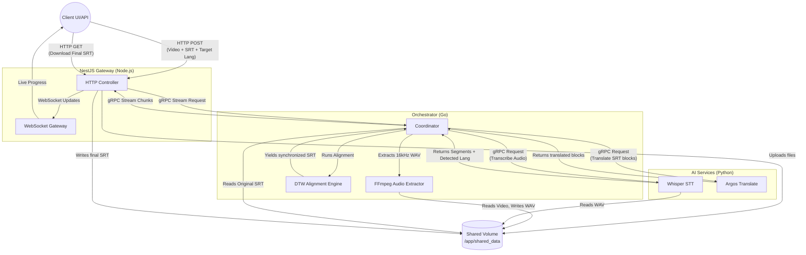

# System Architecture

This project is a microservice-based subtitle synchronization engine. It automatically aligns out-of-sync subtitles (in any language) to the actual spoken dialogue in a video using AI speech-to-text (Whisper) and dynamic programming (DTW).

## High-Level Architecture

The system consists of three separate Docker containers connected via a shared volume and gRPC.

## Service Responsibilities

### 1. NestJS API (`nest-api`)
- **Port:** 3000
- **Role:** Entry point for clients.
- **Tasks:**
  - Handles multipart form uploads (video + SRT).
  - Stores files in the shared Docker volume.
  - Initiates the synchronization job by opening a gRPC stream to the Go worker.
  - Broadcasts sync progress back to clients via WebSocket events.
  - Serves the final synchronized `.srt` file for download.

### 2. Go Worker (`go-worker`)
- **Port:** 50051
- **Role:** The brain/orchestrator of the pipeline.
- **Tasks:**
  - Uses `ffmpeg` to extract a 16kHz mono audio track from the video.
  - Calls the Python service to transcribe the audio and auto-detect the spoken language.
  - Parses the uploaded `.srt` file.
  - Calls the Python service to translate the `.srt` text into the detected spoken language.
  - Runs a full-matrix **Dynamic Time Warping (DTW)** algorithm to perfectly align the translated SRT blocks against the Whisper speech timestamps.
  - Restores the original subtitle language text with the newly corrected timestamps.
  - Streams the updated subtitle chunks back to NestJS.

### 3. Python Translator (`python-translator`)
- **Port:** 50052
- **Role:** AI execution environment (avoids tricky CGo dependencies in the Go worker).
- **Tasks:**
  - **Whisper STT:** Loads the `openai-whisper` tiny model. Takes an audio path, transcribes it, detects the language, and returns precise start/end timestamps for every spoken phrase.
  - **Argos Translate:** Fully offline, open-source neural machine translation. Automatically downloads required language packs and translates text blocks on demand so they can be matched against the Whisper transcription.

## Data Storage
The services share a local volume mapped to `/app/shared_data`. This avoids the need to pass large video files or audio tracks over the network via gRPC. The gRPC payloads only contain file paths, small text blocks, and timing metadata.
